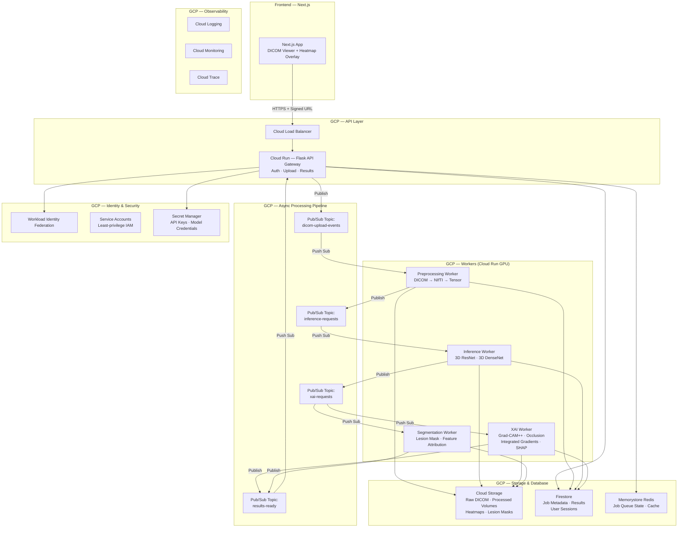
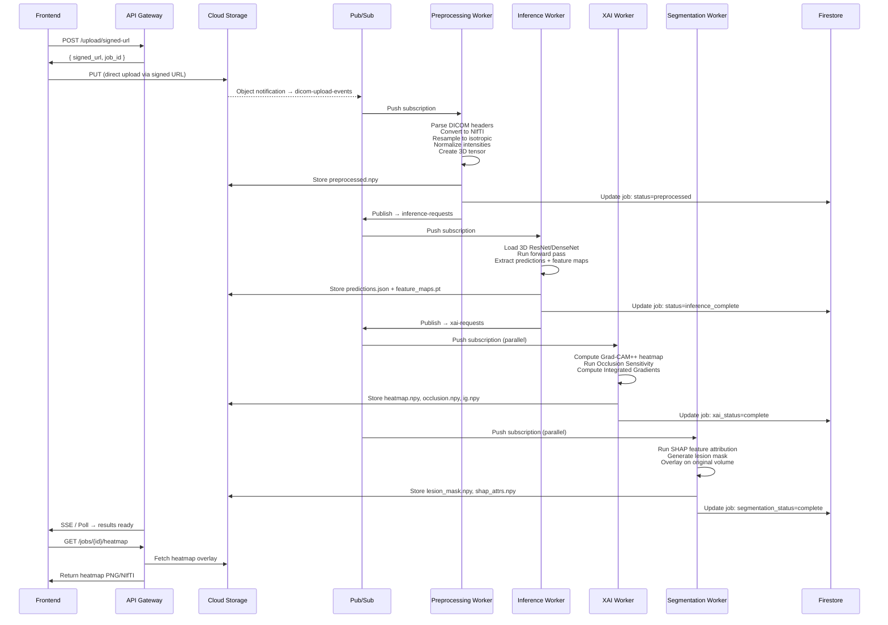
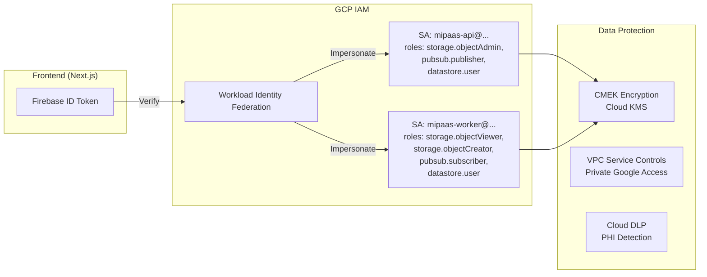

# MIPAAS — GCP Backend Architecture

> **Medical Image Processing As A Software Service**
> GCP-native backend for uploading, processing, and analyzing DICOM/CT/MRI scans with 3D deep learning models and explainable AI

---

## 1. System Overview



---

## 2. Component Deep-Dive

### 2.1 API Gateway — Cloud Run (Flask)

| Concern | Detail |
|---------|--------|
| **Framework** | Flask 3.x with Gunicorn (WSGI, multi-worker) |
| **Auth** | Workload Identity Federation → Service Account tokens; frontend passes Firebase ID token or OAuth2 bearer |
| **Upload Flow** | Generates GCS Signed Upload URLs (V4, 15 min expiry, max 2 GB) — frontend uploads direct-to-GCS, never through the API |
| **Job Management** | CRUD on Firestore `jobs` collection |
| **Results Polling** | REST endpoint + optional Server-Sent Events for real-time status |
| **CORS** | Scoped to frontend domain only |
| **Rate Limiting** | Cloud Armor + per-user Memorystore counters |

#### Key Endpoints

| Method | Route | Purpose |
|--------|-------|---------|
| `POST` | `/api/v1/upload/signed-url` | Generate GCS signed URL for DICOM upload |
| `POST` | `/api/v1/jobs` | Create inference + XAI job |
| `GET` | `/api/v1/jobs/{job_id}` | Poll job status + results |
| `GET` | `/api/v1/jobs/{job_id}/heatmap` | Download Grad-CAM++ heatmap overlay |
| `GET` | `/api/v1/jobs/{job_id}/segmentation` | Download lesion mask + SHAP attribution |
| `GET` | `/api/v1/jobs/{job_id}/dicom-frames` | Serve processed DICOM frames as PNG for viewer |
| `DELETE` | `/api/v1/jobs/{job_id}` | Cancel / cleanup job |
| `GET` | `/api/v1/health` | Health check |

---

### 2.2 Async Processing Pipeline — Pub/Sub + Cloud Run Workers

> [!IMPORTANT]
> DICOM volumes (CT/MRI) can be 500 MB – 2 GB per study. Processing must be fully asynchronous. The API never blocks on inference.

#### Pipeline Stages



---

### 2.3 Model Architecture

#### 3D ResNet (Classification/Risk Prediction)

```
Input: [B, 1, D, H, W] — 3D CT/MRI volume (e.g. 1×64×256×256)
│
├── Conv3d(1→64, 7×7×7, stride=2) + BN + ReLU
├── MaxPool3d(3×3×3, stride=2)
│
├── ResBlock3D×3 (64→64)       ← Layer 1
├── ResBlock3D×4 (64→128)      ← Layer 2
├── ResBlock3D×6 (128→256)     ← Layer 3  ← Grad-CAM++ target
├── ResBlock3D×3 (256→512)     ← Layer 4
│
├── AdaptiveAvgPool3d(1,1,1)
├── FC(512 → num_classes)
└── Sigmoid / Softmax
```

#### 3D DenseNet (Alternative / Ensemble)

```
Input: [B, 1, D, H, W]
│
├── Conv3d(1→64) + BN + ReLU + MaxPool3d
│
├── DenseBlock3D(6 layers, growth=32)   ← 64→256
├── TransitionBlock3D                    ← 256→128
├── DenseBlock3D(12 layers, growth=32)  ← 128→512
├── TransitionBlock3D                    ← 512→256
├── DenseBlock3D(24 layers, growth=32)  ← 256→1024  ← Grad-CAM++ target
├── TransitionBlock3D
├── DenseBlock3D(16 layers, growth=32)
│
├── AdaptiveAvgPool3d(1,1,1)
├── FC → num_classes
└── Sigmoid / Softmax
```

---

### 2.4 XAI Methods — Implementation Strategy

| Method | What It Produces | GCS Artifact | Compute Cost |
|--------|-----------------|--------------|--------------|
| **Grad-CAM++** (Primary) | 3D heatmap highlighting discriminative regions | `heatmap_gradcam.npy` + overlay PNGs | Low — single backward pass |
| **Occlusion Sensitivity** (Validation) | 3D sensitivity map showing output drop when regions occluded | `occlusion_map.npy` | High — O(V/patch_size) forward passes |
| **Integrated Gradients** (Validation) | Per-voxel attribution scores along interpolation path | `integrated_grads.npy` | Medium — N×forward passes (N=steps) |
| **SHAP** (Segmentation) | Feature attribution per voxel via Shapley values | `shap_values.npy` | Very High — approximate with KernelSHAP or DeepSHAP |
| **Lesion Mask** | Binary/probability mask of detected lesions | `lesion_mask.npy` + DICOM-SEG | Medium — threshold on XAI + post-processing |

---

### 2.5 Storage Layout — Cloud Storage

```
gs://mipaas-{env}-data/
├── raw/
│   └── {user_id}/{job_id}/
│       ├── series.dcm           # Original DICOM files (multi-part)
│       └── metadata.json        # DICOM headers
├── processed/
│   └── {job_id}/
│       ├── volume.npy           # Preprocessed 3D tensor
│       ├── volume_meta.json     # Spacing, orientation, etc.
│       └── thumbnail.png        # Middle-slice preview
├── inference/
│   └── {job_id}/
│       ├── predictions.json     # Model output probabilities
│       └── feature_maps.pt      # Intermediate activations (for XAI)
├── xai/
│   └── {job_id}/
│       ├── heatmap_gradcam.npy  # Grad-CAM++ 3D heatmap
│       ├── occlusion_map.npy    # Occlusion sensitivity map
│       ├── integrated_grads.npy # Integrated gradients attribution
│       ├── shap_values.npy      # SHAP feature attribution
│       ├── lesion_mask.npy      # Binary lesion mask
│       └── overlays/
│           ├── axial_{slice}.png
│           ├── coronal_{slice}.png
│           └── sagittal_{slice}.png
└── models/
    ├── resnet3d_lung_v1.pt
    └── densenet3d_lung_v1.pt
```

---

### 2.6 Firestore Schema

```
jobs/{job_id}:
  user_id: string
  created_at: timestamp
  updated_at: timestamp
  status: "uploading" | "preprocessing" | "inference" | "xai_running" | "complete" | "failed"

  # Input metadata
  input:
    gcs_uri: string              # gs://bucket/raw/{user_id}/{job_id}/
    modality: "CT" | "MRI"
    series_description: string
    num_slices: int
    pixel_spacing: [float, float]
    slice_thickness: float

  # Model config
  model:
    name: "resnet3d" | "densenet3d"
    version: string
    checkpoint_uri: string

  # Results
  predictions:
    class_probabilities: map<string, float>
    predicted_class: string
    confidence: float

  # XAI results (paths to GCS artifacts)
  xai:
    gradcam:
      status: string
      gcs_uri: string
      overlay_uris: [string]
    occlusion:
      status: string
      gcs_uri: string
    integrated_gradients:
      status: string
      gcs_uri: string

  # Segmentation results
  segmentation:
    status: string
    lesion_mask_uri: string
    shap_uri: string
    lesion_count: int
    lesion_volumes_mm3: [float]

  # Error tracking
  error:
    stage: string
    message: string
    traceback: string
```

---

## 3. Security Architecture



> [!CAUTION]
> Medical images contain PHI (Protected Health Information). All storage buckets MUST use CMEK encryption. Enable VPC Service Controls to prevent data exfiltration. Implement Cloud DLP scanning on metadata.

### HIPAA Considerations

| Control | Implementation |
|---------|---------------|
| Encryption at rest | CMEK via Cloud KMS (AES-256) |
| Encryption in transit | TLS 1.3 enforced on all endpoints |
| Access logging | Cloud Audit Logs enabled on all resources |
| PHI de-identification | Strip DICOM patient tags before storage (configurable) |
| Data retention | Auto-delete after configurable TTL (default 90 days) |
| BAA | GCP HIPAA BAA covers Cloud Run, GCS, Firestore, Pub/Sub |

---

## 4. Infrastructure as Code (Terraform)

The deployment uses Terraform modules:

| Module | Resources |
|--------|-----------|
| `networking` | VPC, subnets, Cloud NAT, firewall rules |
| `storage` | GCS buckets (raw, processed, inference, xai, models) |
| `pubsub` | Topics + subscriptions (4 topics, push subs to Cloud Run) |
| `cloudrun` | API service + 4 worker services (GPU-enabled) |
| `firestore` | Database + indexes + TTL policies |
| `iam` | Service accounts + IAM bindings + Workload Identity |
| `monitoring` | Dashboards, alerts, uptime checks |
| `security` | Secret Manager, KMS, VPC-SC perimeter |

---

## 5. Cost Optimization

| Strategy | Detail |
|----------|--------|
| **Scale to zero** | Cloud Run workers scale to 0 when idle — no cost at rest |
| **GPU only when needed** | GPU-backed Cloud Run only for inference/XAI workers |
| **GCS lifecycle** | Move raw DICOM to Nearline after 30 days, Coldline after 90 |
| **Pub/Sub batching** | Batch messages to reduce per-message costs |
| **Model caching** | Workers cache model weights in `/tmp` across warm instances |
| **Preemptible GPU** | Use Spot instances for XAI workers (can tolerate retries) |

---

## 6. Directory Structure (Backend)

```
MIPAAS/backend/
├── Dockerfile                    # Multi-stage build for API
├── Dockerfile.worker             # GPU-enabled worker image
├── docker-compose.yml            # Local development
├── pyproject.toml                # Project metadata + dependencies
├── requirements.txt              # Pinned dependencies
├── requirements-worker.txt       # Worker-specific (PyTorch, etc.)
│
├── app/                          # Flask API application
│   ├── __init__.py               # Flask app factory
│   ├── config.py                 # Environment-based configuration
│   ├── routes/
│   │   ├── __init__.py
│   │   ├── upload.py             # Signed URL generation
│   │   ├── jobs.py               # Job CRUD + status
│   │   ├── results.py            # Heatmap / segmentation download
│   │   └── health.py             # Health check
│   ├── services/
│   │   ├── __init__.py
│   │   ├── storage.py            # GCS operations
│   │   ├── pubsub.py             # Pub/Sub publisher
│   │   ├── firestore.py          # Firestore CRUD
│   │   └── auth.py               # Token verification
│   ├── middleware/
│   │   ├── __init__.py
│   │   ├── cors.py               # CORS configuration
│   │   ├── error_handler.py      # Global error handling
│   │   └── rate_limiter.py       # Rate limiting
│   └── utils/
│       ├── __init__.py
│       ├── dicom_utils.py        # DICOM header parsing
│       └── response.py           # Standardized responses
│
├── workers/                      # Async processing workers
│   ├── __init__.py
│   ├── base_worker.py            # Shared Pub/Sub consumer logic
│   ├── preprocessing/
│   │   ├── __init__.py
│   │   ├── worker.py             # Preprocessing pipeline
│   │   ├── dicom_parser.py       # DICOM → NIfTI conversion
│   │   ├── resampler.py          # Isotropic resampling
│   │   └── normalizer.py         # Intensity normalization
│   ├── inference/
│   │   ├── __init__.py
│   │   ├── worker.py             # Model inference pipeline
│   │   ├── model_loader.py       # Model registry + caching
│   │   └── predictor.py          # Forward pass + output formatting
│   ├── xai/
│   │   ├── __init__.py
│   │   ├── worker.py             # XAI pipeline orchestrator
│   │   ├── gradcam_plus.py       # Grad-CAM++ implementation
│   │   ├── occlusion.py          # Occlusion sensitivity
│   │   ├── integrated_grads.py   # Integrated Gradients
│   │   └── overlay_generator.py  # Heatmap → PNG overlay
│   └── segmentation/
│       ├── __init__.py
│       ├── worker.py             # Segmentation pipeline
│       ├── shap_attributor.py    # SHAP/DeepSHAP
│       └── lesion_mask.py        # Mask generation + post-processing
│
├── models/                       # Model definitions
│   ├── __init__.py
│   ├── resnet3d.py               # 3D ResNet architecture
│   └── densenet3d.py             # 3D DenseNet architecture
│
├── terraform/                    # Infrastructure as Code
│   ├── main.tf
│   ├── variables.tf
│   ├── outputs.tf
│   ├── modules/
│   │   ├── cloudrun/
│   │   ├── pubsub/
│   │   ├── storage/
│   │   ├── firestore/
│   │   ├── iam/
│   │   └── networking/
│   └── environments/
│       ├── dev.tfvars
│       ├── staging.tfvars
│       └── prod.tfvars
│
├── tests/
│   ├── conftest.py
│   ├── test_routes/
│   ├── test_services/
│   ├── test_workers/
│   └── test_models/
│
└── scripts/
    ├── deploy.sh                 # CI/CD deployment script
    ├── seed_models.sh            # Upload model checkpoints to GCS
    └── local_dev.sh              # Start local dev environment
```

---

## 7. Performance Targets

| Metric | Target |
|--------|--------|
| Upload → signed URL response | < 200 ms |
| DICOM preprocessing (500 slices) | < 60 s |
| Model inference (3D ResNet) | < 30 s (T4 GPU) |
| Grad-CAM++ generation | < 15 s |
| Occlusion sensitivity (full) | < 5 min |
| Integrated gradients (50 steps) | < 2 min |
| SHAP attribution (DeepSHAP) | < 3 min |
| End-to-end pipeline | < 10 min |
| Cold start (Cloud Run) | < 45 s (with model cache) |
