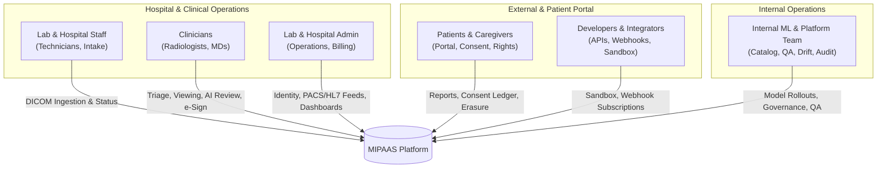
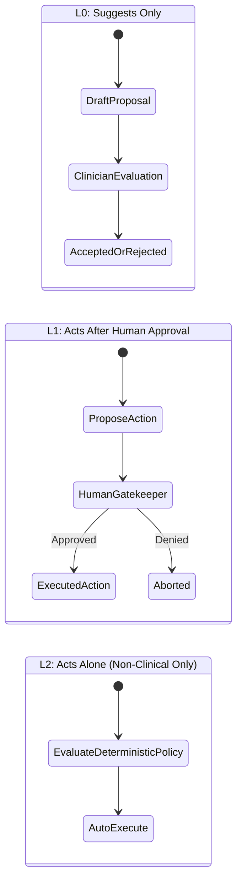
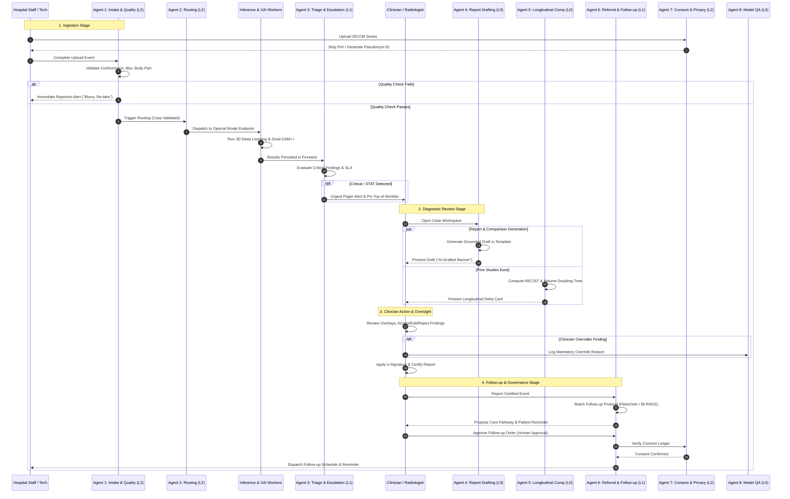

# MIPAAS: Web App Feature Blueprint & Autonomous Agent Architecture

This specification formalizes the clinical product features across six key user personas and provides an exhaustive, production-grade definition for each system agent in the MIPAAS platform.

---

## 1. Web Application Features by Persona



---

### 1.1 Lab and Hospital Staff (Technicians & Ingestion Coordinators)

*Primary Objective:* Seamless, fault-tolerant acquisition of high-resolution medical imaging data with real-time validation and zero lost studies.

| Capability | Detailed Functional Workflow | Technical & UX Specifications |
| :--- | :--- | :--- |
| **Multi-Channel Resumable Ingestion** | • Drag-and-drop file/folder uploader (supports nested DICOM directory structures).<br/>• Direct GCS signed resumable upload protocol (chunked, pause/resume capability, network drop recovery).<br/>• Automated background PACS push listener (DIMSE C-STORE SCP / DICOMweb STOW-RS). | • Chunk size: 8 MB - 32 MB with SHA-256 integrity validation per chunk.<br/>• Direct-to-storage client bypass avoids API gateway memory bottleneck.<br/>• Real-time progress bar with upload speed, remaining time, and slice counter. |
| **Pseudonymous Worklist & Patient Timeline** | • Master case list indexed by cryptographic pseudonymous patient IDs (e.g., `MIP-8842-X`).<br/>• Longitudinal timeline visualizing all imaging encounters across modalities (CT, MRI, X-ray) chronologically.<br/>• Faceted search by acquisition date, referring clinic, body part, and processing status. | • No raw PII exposed in the ingestion table (Name and DOB de-identified at client edge or during ingestion gateway handshake).<br/>• Sub-50ms fuzzy filtering across 100k+ historical encounters. |
| **Instant Quality & Conformance Feedback** | • Instant client feedback modal/toast triggered immediately after upload/intake.<br/>• Evaluates image blurriness, slice discontinuity, incorrect projection/view, or truncated anatomy.<br/>• Immediate prompt: *"Warning: Severe motion blur detected (Laplacian variance 14.2 < 45.0 threshold). Recommend re-take before patient departure."* | • Vision classifier + header conformance runs within < 2.5 seconds.<br/>• Prevents bad scans from reaching radiologist worklists or triggering paid downstream inference pipelines. |

---

### 1.2 Clinicians (Radiologists, Specialists, & Attending Physicians)

*Primary Objective:* High-throughput, diagnostic-grade review workspace combining AI explainability with uncompromised human oversight and legal defensibility.

| Capability | Detailed Functional Workflow | Technical & UX Specifications |
| :--- | :--- | :--- |
| **SLA-Driven Priority Worklist** | • Real-time dynamic queue sorted by clinical severity: **STAT** (e.g., suspected Intracranial Hemorrhage, Pneumothorax), **URGENT**, and **ROUTINE**.<br/>• Live countdown SLA clocks with color progression (Green $\rightarrow$ Yellow $\rightarrow$ Pulsing Red).<br/>• Visual badges indicating presence of positive AI findings. | • Dynamic WebSocket/SSE updates re-rank the worklist instantly as critical results arrive.<br/>• Visual audio cue for incoming STAT cases with an audit-logged delivery receipt. |
| **Embedded Diagnostic DICOM & Explainability Viewer** | • High-performance WebGL viewer (multi-frame 3D MPR: Axial, Coronal, Sagittal).<br/>• Multi-layer AI overlays: Grad-CAM++ activation heatmaps, SHAP voxel attributions, and precise lesion masks with opacity sliders.<br/>• Synchronous side-by-side prior-study comparison with linked cross-hairs, pan, zoom, and window level synchronization (Lung, Bone, Brain, Soft Tissue presets). | • Window presets: W/L 1500/-600 (Lung), 400/40 (Mediastinum), 80/40 (Brain), 2000/300 (Bone).<br/>• Real-time toggle ($G$) to isolate Grad-CAM++ layer without losing underlying DICOM pixel fidelity. |
| **Granular Finding Review & Mandatory Override Capture** | • Interactive finding cards listing model detections (e.g., *Subsolid pulmonary nodule, 8.4mm, Right Upper Lobe, Malignancy risk: 78%*).<br/>• Action controls for each finding: **Accept**, **Edit** (modify dimensions/classification), or **Reject**.<br/>• **Mandatory Override Modal:** If clinician rejects or alters an AI finding, they must select an override reason code (*e.g., False Positive - Vessel Congestion, Artifact Misidentified, Dimension Recalibrated*) + optional clinical notes. | • Override data streams directly to the Model QA and Drift monitoring pipeline.<br/>• Establishes legal provenance showing clinician maintained ultimate decision authority. |
| **Template-Driven Structured Report Editor & e-Sign** | • Auto-populated structured reporting templates (Lung-RADS v2022, BI-RADS 6th ed., RadLex).<br/>• Draft prose generated strictly from accepted findings with interactive clickable source citations.<br/>• Cryptographic e-signature workflow binding clinician medical registration ID, timestamp, and digital certificate to the final PDF/FHIR report. | • e-Signature locks the study against subsequent edits and initiates distribution to PACS/EMR.<br/>• Generates FHIR `DiagnosticReport` resource and HL7 v2 `ORU^R01` messages. |
| **Critical Result Alert & Acknowledgement Protocol** | • High-priority intrusive notification modal for life-threatening findings requiring immediate verbal/digital sign-off.<br/>• Two-way closed-loop acknowledgement: Clinician must press *"Acknowledge STAT Result"* within 15 minutes or system triggers escalation pings to department head. | • Every notification, view, and acknowledgement timestamp is immutably logged for medicolegal compliance (Joint Commission standard). |

---

### 1.3 Lab Admin (Hospital Operations & Technical Administrators)

*Primary Objective:* Secure multi-tenant governance, interface interoperability, and real-time operational cost management.

| Capability | Detailed Functional Workflow | Technical & UX Specifications |
| :--- | :--- | :--- |
| **Identity, Role & Multi-Site Governance** | • Enterprise RBAC with granular permission scopes (`ROLE_TECHNICIAN`, `ROLE_RADIOLOGIST`, `ROLE_CHIEF_OF_MED`, `ROLE_LAB_ADMIN`, `ROLE_AUDITOR`).<br/>• Site and tenant hierarchy (e.g., Hospital Network $\rightarrow$ Regional Facility $\rightarrow$ Imaging Center).<br/>• Scoped API key creation with IP whitelisting and auto-rotation policies. | • SAML 2.0 / OAuth2 / OIDC integration with Hospital Active Directory / Okta.<br/>• Complete session timeout and multi-factor authentication (MFA) enforcement. |
| **Interoperability & Integration Hub** | • PACS Configuration: DICOM Application Entity (AE) titles, ports, IP endpoints, and DICOMweb endpoints.<br/>• HL7 v2 and FHIR R4 interfaces: MLLP endpoint bindings, FHIR server URLs, and OAuth2 credentials.<br/>• Interactive ping and loopback test harness to verify DICOM `C-ECHO` and HL7 handshake without transmitting patient data. | • Field mapping engine: Configurable translation of hospital local procedure codes to LOINC and SNOMED-CT. |
| **Usage, Billing & Turnaround Analytics** | • Real-time operational dashboard visualizing case volume, GPU processing duration, and cloud storage allocation per site.<br/>• Financial cost tracker: Per-case inference cost breakdown across model vendors.<br/>• SLA and Turnaround Time (TAT) distribution curves: Ingestion-to-read, read-to-sign, and critical alert response latencies. | • Exportable CSV/PDF operational reports for hospital leadership.<br/>• Automated alerting when tenant consumption reaches 80% and 95% of monthly credit limit. |

---

### 1.4 Patients & Caregivers

*Primary Objective:* Transparent access to certified health reports, sovereign consent controls, and privacy rights compliance.

| Capability | Detailed Functional Workflow | Technical & UX Specifications |
| :--- | :--- | :--- |
| **Patient-Centric Report View** | • Secure, accessible report viewer presenting certified clinical findings.<br/>• Plain-language terminology tooltips alongside medical terminology (e.g., hover on "Ground-glass opacity" explains concept without altering clinician's text).<br/>• High-contrast and screen-reader accessibility (WCAG 2.1 AA certified). | • Clear banner indicating study has been reviewed and signed by a licensed radiologist.<br/>• Downloadable cryptographically signed PDF report with embedded verification QR code. |
| **Dynamic Consent & Purpose Controls** | • Granular consent toggles: (1) Primary diagnostic care, (2) Institutional QA, (3) Secondary de-identified academic research, (4) Commercial AI algorithm improvement.<br/>• Ability to modify or revoke consent at any time with immediate downstream enforcement. | • Integrated with Consent & Privacy Agent ledger.<br/>• Zero impact on clinical treatment if secondary research consent is declined. |
| **Expiring Secure Share Links** | • Generate time-limited, access-controlled shareable links for second opinions or referral physicians.<br/>• Security challenge: Recipient must pass OTP SMS verification or pass-code validation.<br/>• Expiration configuration: 24 hours, 7 days, or 30 days with one-click revocation. | • Watermarked viewer prevents unauthorized screen captures.<br/>• Full audit logging of link creation, recipient IP, and view duration. |
| **Data Erasure & Access Requests (GDPR / HIPAA)** | • Self-service portal to submit "Right to Erasure" (Right to be Forgotten) and "Right to Access" requests.<br/>• Status tracker showing request validation, clinical retention policy check (statutory minimum retention verification), and cascading purging across all data tiers. | • Automated audit certificate issued upon verified completion of data erasure.<br/>• Transparent explanations when statutory medical record retention laws supersede erasure. |

---

### 1.5 Internal Platform & ML Operations Team

*Primary Objective:* End-to-end model lifecycle governance, tenant feature gating, safety benchmarking, and compliance auditing.

| Capability | Detailed Functional Workflow | Technical & UX Specifications |
| :--- | :--- | :--- |
| **Model Catalog & Lifecycle Management** | • Centralized catalog of proprietary and 3rd-party vendor models (e.g., `ChestXRay-DenseNet-v2.1`, `BrainMRI-3DResNet-v1.4`).<br/>• Version control, regulatory clearance tagging (FDA 510(k), CE Class IIa, RUO), and hardware requirements.<br/>• Automated staging pipelines: Blue/Green and Canary model deployments with instant rollback capability. | • Model manifest tracks training data provenance, intended use, contraindications, and baseline sensitivity/specificity curves. |
| **Per-Tenant Model Enablement** | • Tenant feature-flag matrix: Enable/disable specific models per hospital contract and clinical specialty.<br/>• Configure model execution cascades (e.g., Primary Model $\rightarrow$ Fallback Model).<br/>• Budget caps and throttle thresholds per tenant. | • Real-time configuration propagation across inference clusters within 10 seconds via distributed key-value store. |
| **Model Performance & Drift Monitor** | • Live monitoring of clinician acceptance vs. override rates partitioned by model, anatomical site, and hospital facility.<br/>• Continuous statistical drift monitoring: Population Stability Index (PSI) and Wasserstein distance on input tensor distributions and output logits.<br/>• Automatic alerting if a model's override rate spikes above threshold (> 12%). | • Site-by-site anomaly detection identifies scanner-specific calibration drifts (e.g., GE vs. Siemens imaging variance). |
| **Immutable Audit & Compliance Search** | • Cryptographically chained audit log search tool.<br/>• Query by case hash, operator ID, tenant ID, or timestamp across all system events: uploads, inferences, XAI computations, views, and edits.<br/>• Verifiable non-repudiation logs suitable for FDA, HIPAA, and ISO 27001 regulatory audits. | • Write-once-read-many (WORM) storage backed by Cloud KMS asymmetric signatures. |

---

### 1.6 Developers & Integrators

*Primary Objective:* Frictionless, secure, standards-compliant integration into existing EMR, PACS, and custom health-tech stacks.

| Capability | Detailed Functional Workflow | Technical & UX Specifications |
| :--- | :--- | :--- |
| **Interactive Developer Sandbox** | • Isolated sandbox environment pre-populated with anonymized multi-modal DICOM benchmarks.<br/>• Real-time mock inference responses simulating various pathological findings, edge cases, and error states.<br/>• Zero billable inference and zero risk of PHI contamination. | • Instant credential provisioning with separate sandbox API keys.<br/>• Reset state button to restore sandbox to clean baseline. |
| **API Documentation & SDKs** | • Interactive OpenAPI 3.1 / Swagger documentation with runnable curl and code samples.<br/>• Native SDKs for Python and TypeScript/Node.js.<br/>• Standardized DICOMweb (`WADO-RS`, `QIDO-RS`, `STOW-RS`) and FHIR R4 DiagnosticReport compatibility guides. | • Code generators for common integration patterns (e.g., auto-polling, webhook handlers, signed upload clients). |
| **API Key & Scoped Credential Management** | • Self-service generation of fine-grained API keys with least-privilege permission grants (e.g., `study:write`, `study:read`, `inference:trigger`).<br/>• CIDR IP range restrictions, rate limit customization, and automated key rotation webhooks. | • Keys hashed using Argon2id; displayed exactly once at creation. |
| **Webhook Delivery & Event Subscriptions** | • Configure webhook endpoints for event subscriptions (`study.intake.validated`, `inference.completed`, `case.triaged.stat`, `report.signed`).<br/>• Cryptographic payload verification via HMAC-SHA256 signatures (`X-MIPAAS-Signature`).<br/>• Real-time webhook delivery console with request/response payloads, latency metrics, and manual replay buttons. | • Automated exponential backoff with dead-letter queue (DLQ) after 5 failed delivery attempts. |

---

## 2. Autonomous Agent Architecture & Framework

### 2.1 The Clinical Autonomy Hierarchy

Every agent in MIPAAS is strictly classified into one of three autonomy tiers.



> [!CAUTION]
> **The Clinical Safety Invariant:**
> Under no circumstances may any agent operate at **L2** for clinical interpretation, diagnosis, triage downgrade, or therapy recommendation. All clinical diagnostic decisions require a licensed medical professional in the loop.

* **L0 (Suggests Only):** Generates drafts, overlays, or analytical comparisons. Completely passive until reviewed by a clinician. Cannot persist changes to medical records or trigger external workflows.
* **L1 (Acts After Human Approval):** Prepares high-impact actions (e.g., clinical referrals, diagnostic worklist downgrades, communication dispatches). Requires explicit human sign-off before executing.
* **L2 (Acts Alone — Non-Clinical Only):** Autonomous execution restricted exclusively to non-clinical, deterministic tasks: validating DICOM conformance, network routing, anonymization, privacy policy enforcement, and technical intake checks.

---

### 2.2 Complete Specifications for All 9 Agents

---

### Agent 1: Intake & Quality Agent

| Attribute | Specification |
| :--- | :--- |
| **Goal** | Validate incoming DICOM files, verify header-pixel conformance, catch wrong body parts/views/lateralities, detect unusable image quality (blur, motion, clipping), and reject non-viable scans before initiating paid model pipelines. |
| **Trigger** | Upload complete event (`study.upload.completed` or DICOM C-STORE push finalized). |
| **Inputs** | Raw DICOM byte stream / series directory; DICOM header metadata (`Modality`, `StudyDescription`, `BodyPartExamined`, `ViewPosition`, `PatientOrientation`, `PhotometricInterpretation`, `Rows`, `Columns`); raw pixel array. |
| **Allowed Tools (Allowlist Only)** | • `dicom_header_parser`: Extracts and validates standard DICOM Part 10 tags.<br/>• `pixel_quality_analyzer`: Computes blur index (Laplacian variance), signal-to-noise ratio (SNR), contrast dynamic range, and slice continuity.<br/>• `bodypart_view_classifier`: Small, non-LLM vision classifier (MobileNetV3/ResNet18) predicting body part, projection view, and laterality.<br/>• `set_case_intake_status`: Updates case state to `VALIDATED` or `REJECTED_QUALITY`.<br/>• `emit_intake_telemetry`: Emits real-time feedback payload to the intake technician interface. |
| **Output Schema** | ```json<br/>{<br/>  "case_id": "string (uuid)",<br/>  "validation_status": "PASSED" | "REJECTED",<br/>  "modality_check": { "declared": "string", "conforming": true },<br/>  "bodypart_check": {<br/>    "declared": "string",<br/>    "predicted": "string",<br/>    "view_detected": "PA" | "AP" | "LATERAL" | "AXIAL",<br/>    "confidence": 0.98,<br/>    "match": true<br/>  },<br/>  "quality_metrics": {<br/>    "laplacian_variance": 54.2,<br/>    "snr_db": 22.8,<br/>    "motion_detected": false,<br/>    "slice_gap_irregularity": false,<br/>    "quality_score": 0.94<br/>  },<br/>  "rejection_code": "NONE" | "BLUR_EXCESSIVE" | "BODYPART_MISMATCH" | "CORRUPTED_PIXELS",<br/>  "technician_message": "string"<br/>}<br/>``` |
| **Autonomy Level** | **L2** *(Non-clinical operational gatekeeper; acts alone to halt processing of unviable inputs).* |
| **Guardrails** | • Zero patient PII processed (agent operates on de-identified headers and pixel tensors only).<br/>• Rejection threshold requires high model confidence ($\ge 0.92$). If body-part classification confidence is indeterminate ($0.50 - 0.91$), the agent does not reject; it flags the scan for technician review (`FLAGGED_FOR_MANUAL_INTAKE`).<br/>• Cannot execute diagnostic models or generate medical opinions. |
| **Metrics** | • Pre-inference rejection rate (% of defective scans intercepted).<br/>• Technician override rate of rejected cases (target $< 1.0\%$).<br/>• Execution latency (target $< 2.5\text{ seconds}$ on 500-slice volume).<br/>• Inference cost avoided via early rejection. |
| **Failure Behaviour** | If classifier or quality checks time out or throw an unhandled exception, fail-safe to `FLAGGED_FOR_MANUAL_INTAKE`. The scan is never dropped silently, and paid downstream inference is halted until verified. |

---

### Agent 2: Routing Agent

| Attribute | Specification |
| :--- | :--- |
| **Goal** | Determine and dispatch the optimal AI model(s) for a validated study based on modality, clinical indication, tenant configuration, and service availability, falling back to secondary models if primary fails. |
| **Trigger** | Case validated event (`case.intake.status == VALIDATED`). |
| **Inputs** | Validated study metadata (modality, body part, view, protocol description, SNOMED/ICD indication code); tenant contract profile (licensed models, tier, budget caps); real-time model catalog health state. |
| **Allowed Tools (Allowlist Only)** | • `read_tenant_contract`: Retrieves enabled models, vendor preferences, and concurrency quotas for tenant.<br/>• `query_model_registry`: Inspects registered model endpoints, regulatory tags, and operational versions.<br/>• `check_endpoint_health`: Verifies circuit-breaker status, latency, and queue depth of model workers.<br/>• `dispatch_inference_job`: Publishes execution message to targeted Pub/Sub topic with primary and fallback route parameters. |
| **Output Schema** | ```json<br/>{<br/>  "case_id": "string (uuid)",<br/>  "routing_plan": {<br/>    "primary_target": {<br/>      "model_id": "resnet3d-pulmonary-v2",<br/>      "endpoint": "workers.inference.internal",<br/>      "timeout_ms": 30000<br/>    },<br/>    "fallback_target": {<br/>      "model_id": "densenet3d-pulmonary-v1",<br/>      "endpoint": "workers.inference-backup.internal",<br/>      "timeout_ms": 35000<br/>    },<br/>    "xai_pipeline_required": true,<br/>    "max_cost_allocation_cents": 150<br/>  },<br/>  "dispatched_at": "string (ISO8601)"<br/>}<br/>``` |
| **Autonomy Level** | **L2** *(Non-clinical technical orchestration; acts alone on deterministic routing policies).* |
| **Guardrails** | • Tenant strict boundary: Never routes a tenant's study to models or 3rd-party vendors not explicitly consented in their contract.<br/>• Regulatory gate: Never dispatches a clinical diagnostic study to models tagged `EXPERIMENTAL` or `RUO` (Research Use Only).<br/>• Circuit-breaker: If an endpoint fails 3 consecutive requests, it is marked degraded and traffic shifts to fallback. |
| **Metrics** | • Routing latency (target $< 35\text{ ms}$).<br/>• Fallback invocation rate (% of jobs routed to secondary endpoint).<br/>• Route failure rate (target $0.00\%$).<br/>• Cost adherence (% of jobs within tenant tier budget). |
| **Failure Behaviour** | If no healthy model matches the study's modality and indication, marks case as `ROUTING_FAILED_NO_HEALTHY_BACKEND`, alerts the on-call platform SRE, and moves the study directly to the unassisted clinician worklist without silent stalls. |

---

### Agent 3: Triage & Escalation Agent

| Attribute | Specification |
| :--- | :--- |
| **Goal** | Dynamically rank cases on the clinician worklist, track SLA countdown timers, and issue urgent notifications for suspected life-threatening (STAT) findings. |
| **Trigger** | Result stored event (`inference.completed` and findings persisted in Firestore). |
| **Inputs** | Structured finding predictions (critical pathology flags e.g., intracranial hemorrhage, pneumothorax, pulmonary embolism, aortic dissection); order request priority (`ROUTINE`, `URGENT`, `STAT`); study acquisition timestamp; tenant SLA rulebook. |
| **Allowed Tools (Allowlist Only)** | • `read_finding_severity`: Reads class probabilities and critical alert tags from inference output.<br/>• `update_worklist_rank`: Reorders clinician queue and assigns priority class (`STAT`, `URGENT`, `ROUTINE`).<br/>• `set_sla_countdown`: Configures and starts SLA countdown clock with target breach time.<br/>• `send_critical_pager`: Dispatches high-priority alert via Webhook/WebSocket/Twilio to on-call radiologist. |
| **Output Schema** | ```json<br/>{<br/>  "case_id": "string (uuid)",<br/>  "assigned_priority": "STAT" | "URGENT" | "ROUTINE",<br/>  "critical_alert": {<br/>    "triggered": true,<br/>    "pathology": "TENSION_PNEUMOTHORAX",<br/>    "model_confidence": 0.94,<br/>    "sla_minutes": 15,<br/>    "deadline_timestamp": "string (ISO8601)"<br/>  },<br/>  "escalation_actions": [<br/>    { "action": "WORKLIST_PIN_TOP", "status": "COMPLETED" },<br/>    { "action": "PAGE_ON_CALL_ROSTER", "status": "DISPATCHED" }<br/>  ]<br/>}<br/>``` |
| **Autonomy Level** | **L1** *(Acts after human approval for clinical interventions; automated priority escalation requires explicit human acknowledgement).* |
| **Guardrails** | • **Monotonic Escalation Rule:** Priority may be autonomously upgraded (e.g., `ROUTINE` $\rightarrow$ `STAT` upon detecting acute pathology), but can **NEVER** be downgraded autonomously. Downgrading priority requires explicit clinician sign-off.<br/>• Mandatory two-step acknowledgement: Critical STAT alerts page the on-call radiologist every 5 minutes until digitally acknowledged in the viewer. |
| **Metrics** | • Time from inference result to worklist escalation (target $< 5\text{ seconds}$).<br/>• SLA compliance rate (% of STAT cases reviewed within 15 min).<br/>• Time to clinician alert acknowledgement (target $< 180\text{ seconds}$).<br/>• Critical finding false-positive escalation rate. |
| **Failure Behaviour** | If severity scoring fails or inputs are corrupted, default to highest safe urgency (`URGENT`), flag with `TRIAGE_EVAL_ERROR`, and notify staff to perform manual priority assignment. |

---

### Agent 4: Report Drafting Agent

| Attribute | Specification |
| :--- | :--- |
| **Goal** | Draft a structured radiological report in the tenant's clinical template based strictly on validated AI findings and clinical context, ready for clinician editing and e-signing. |
| **Trigger** | Clinician opens case workspace (`case.workspace.opened`). |
| **Inputs** | Structured findings JSON (detected abnormalities, locations, dimensions, probabilities); quality metrics; de-identified clinical indication note; prior report summary; tenant report template ID. Receives **no** raw pixel data or patient PII. |
| **Allowed Tools (Allowlist Only)** | • `read_case_findings`: Reads structured AI detections and confidence scores.<br/>• `fetch_report_template`: Retrieves institutional reporting structure (e.g., Lung-RADS, RadLex format).<br/>• `validate_sentence_provenance`: Grounding validator verifying that every generated sentence is mapped to an input finding ID.<br/>• `save_report_draft`: Stores draft report in clinician workspace with an uncommitted status. |
| **Output Schema** | ```json<br/>{<br/>  "draft_id": "string (uuid)",<br/>  "case_id": "string (uuid)",<br/>  "template_used": "LUNG_RADS_V2022",<br/>  "sections": [<br/>    {<br/>      "name": "CLINICAL_INDICATION",<br/>      "text": "58-year-old screening evaluation for pulmonary nodule.",<br/>      "source_finding_ids": []<br/>    },<br/>    {<br/>      "name": "FINDINGS",<br/>      "text": "Solid nodule identified in the right upper lobe measuring 8.4mm with smooth margins.",<br/>      "source_finding_ids": ["fnd_9921_rul_nodule"]<br/>    },<br/>    {<br/>      "name": "IMPRESSION",<br/>      "text": "Lung-RADS Category 4A: Suspicious nodule warranting 3-month follow-up CT.",<br/>      "source_finding_ids": ["fnd_9921_rul_nodule"]<br/>    }<br/>  ],<br/>  "compliance_banner": "AI-drafted, requires clinician review and e-signature",<br/>  "grounding_check_passed": true<br/>}<br/>``` |
| **Autonomy Level** | **L0** *(Suggests only. The clinician must review, edit, and cryptographically sign before any downstream clinical use).* |
| **Guardrails** | • **Zero Hallucination Constraint:** Deterministic grounding checker verifies that every clinical sentence cites at least one verified `source_finding_id`. If any sentence contains an ungrounded claim, the entire prose draft is rejected.<br/>• Never invents a diagnosis, staging, or recommendation absent from findings.<br/>• Draft is watermarked with an indelible disclaimer: *"AI-drafted, requires clinician review and e-signature"*. |
| **Metrics** | • Clinician edit distance (% of characters modified before signature).<br/>• Radiologist drafting time saved.<br/>• Number of ungrounded assertions caught by validator (target: $0$).<br/>• Clinician draft acceptance rate without major restructuring. |
| **Failure Behaviour** | If the grounding validator fails or the LLM generation encounters an error, suppress all generated prose completely. Display only the raw structured findings table and key measurements with an empty editor. |

---

### Agent 5: Longitudinal Comparison Agent

| Attribute | Specification |
| :--- | :--- |
| **Goal** | Quantify and summarize interval progression, regression, or stability of anatomical lesions across historical imaging studies for the same pseudonymous patient. |
| **Trigger** | Case has prior studies indexed under patient pseudonymous ID (`patient.has_priors == true`). |
| **Inputs** | Current study structured findings (lesion coordinates, diameters, volumes); prior studies findings JSON; inter-study interval (elapsed days); spatial co-registration matrix. |
| **Allowed Tools (Allowlist Only)** | • `fetch_prior_findings`: Retrieves historical findings, measurements, and coordinates.<br/>• `calculate_recist_delta`: Computes 1D RECIST 1.1 changes, 3D volumetric growth percentage, and Volume Doubling Time (VDT).<br/>• `store_comparison_summary`: Saves comparative delta cards and linked viewport coordinates to the viewer session. |
| **Output Schema** | ```json<br/>{<br/>  "case_id": "string (uuid)",<br/>  "prior_case_id": "string (uuid)",<br/>  "interval_days": 184,<br/>  "lesion_comparisons": [<br/>    {<br/>      "lesion_id": "lesion_rul_01",<br/>      "anatomical_site": "Right Upper Lobe",<br/>      "prior_dimensions_mm": [6.1, 5.8],<br/>      "current_dimensions_mm": [8.4, 7.9],<br/>      "volume_change_percent": 48.2,<br/>      "volume_doubling_time_days": 326,<br/>      "recist_classification": "PROGRESSION"<br/>    }<br/>  ],<br/>  "overall_assessment": "PROGRESSION",<br/>  "registration_confidence": 0.91<br/>}<br/>``` |
| **Autonomy Level** | **L0** *(Suggests only. Provides provisional delta analytics for radiologist verification).* |
| **Guardrails** | • Registration sanity check: If spatial cross-registration confidence is $< 0.80$, rejects automated 3D volume matching and reports only non-spatial aggregate metrics with an explicit alignment disclaimer.<br/>• Cross-modality block: Prohibits direct volumetric comparisons across incompatible imaging protocols (e.g., non-contrast low-dose CT vs. contrast-enhanced high-resolution CT) without clinician override. |
| **Metrics** | • Agreement rate between agent-computed RECIST classification and clinician final interpretation.<br/>• Mathematical accuracy of volume doubling time (VDT) calculations.<br/>• Clinician time reduction in multi-study comparison cases. |
| **Failure Behaviour** | If priors are corrupt or registration fails, mark comparative status as `PRIOR_COMPARISON_UNAVAILABLE`, output no comparison text, and present uncoupled viewports. |

---

### Agent 6: Referral & Follow-up Agent

| Attribute | Specification |
| :--- | :--- |
| **Goal** | Identify clinical protocol recommendations for signed positive results (e.g., Fleischner Society guidelines, BI-RADS management), track loop-closure, and draft consented patient reminders. |
| **Trigger** | Clinician signs report containing positive findings (`report.signed_and_certified`). |
| **Inputs** | Final signed report text; structured diagnostic codes (Lung-RADS, BI-RADS category, Fleischner classification); patient consent ledger record; institutional clinical pathway configuration. |
| **Allowed Tools (Allowlist Only)** | • `match_protocol_guidelines`: Queries institutional evidence-based guidelines for recommended follow-up intervals.<br/>• `draft_referral_order`: Prepares draft referral or follow-up imaging order for physician review.<br/>• `create_loop_closure_tracker`: Registers case in hospital care coordinator tracking database.<br/>• `draft_patient_communication`: Prepares plain-language reminder notification for consented channels (SMS/Email/Portal). |
| **Output Schema** | ```json<br/>{<br/>  "case_id": "string (uuid)",<br/>  "applied_guideline": "FLEISCHNER_2017_SOLID_NODULE",<br/>  "recommended_action": "FOLLOWUP_CT",<br/>  "interval_months": 3,<br/>  "draft_order": {<br/>    "procedure_name": "Chest CT without contrast (low-dose)",<br/>    "clinical_rationale": "Follow-up 8.4mm solid RUL nodule per Fleischner criteria."<br/>  },<br/>  "patient_message_draft": {<br/>    "channel": "PORTAL",<br/>    "consented": true,<br/>    "text": "Your care team recommends a routine follow-up scan in 3 months. View your secure details here."<br/>  },<br/>  "requires_physician_signature": true<br/>}<br/>``` |
| **Autonomy Level** | **L1** *(Acts after human approval. Zero orders or communications can be dispatched without explicit physician or care coordinator authorization).* |
| **Guardrails** | • Signed Report Gate: Agent will not trigger on preliminary or draft reports.<br/>• Zero Unconsented Communication: Strictly validates patient consent ledger before drafting communications; halts if consent is absent.<br/>• Plain-language tone: Reminders are empathetic and avoid alarmist medical jargon. |
| **Metrics** | • Closed-loop follow-up completion rate (% of recommended follow-ups completed on schedule).<br/>• Physician acceptance rate of proposed follow-up orders.<br/>• Patient opt-out or complaint rate (target $< 0.1\%$). |
| **Failure Behaviour** | If protocol mapping is ambiguous or unsupported, create a reminder task: `MANUAL_PATHWAY_DETERMINATION_REQUIRED` for the clinical care coordinator; no automated draft order is scheduled. |

---

### Agent 7: Consent & Privacy Agent

| Attribute | Specification |
| :--- | :--- |
| **Goal** | Enforce purpose-specific consent constraints on every data query, execute irreversible data erasure requests (GDPR/HIPAA), and write tamper-proof audit trails. |
| **Trigger** | Every data access, export, or erasure request (`data.access.requested` or `erasure.requested`). |
| **Inputs** | Actor ID and role; requested resource ID; purpose of use declaration (`CLINICAL_CARE`, `SECONDARY_RESEARCH`, `MODEL_TRAINING`); patient consent record; statutory data retention rules. |
| **Allowed Tools (Allowlist Only)** | • `query_consent_registry`: Validates whether patient consent covers the requested purpose.<br/>• `apply_dynamic_pseudonymization`: Strips DICOM Part 10 PII tags and replaces patient identifiers with cryptographic hashes.<br/>• `purge_patient_records`: Executes hard-deletion across GCS, Firestore, and Memorystore Redis.<br/>• `append_immutable_audit`: Writes cryptographically signed audit log record to Cloud Logging and KMS. |
| **Output Schema** | ```json<br/>{<br/>  "access_id": "string (uuid)",<br/>  "decision": "PERMIT" | "DENY" | "REDACT_AND_PERMIT",<br/>  "purpose": "SECONDARY_RESEARCH",<br/>  "pseudonym_id": "MIP-HASH-9921",<br/>  "redacted_tags": ["PatientName", "PatientBirthDate", "InstitutionName"],<br/>  "audit_hash": "sha256-e3b0c44298fc1c149afbf4c8996fb92427ae41e4649b934ca495991b7852b855"<br/>}<br/>``` |
| **Autonomy Level** | **L2** *(Non-clinical compliance engine; acts alone on strict zero-trust legal and privacy policies).* |
| **Guardrails** | • **Fail-Secure Default:** If consent record is missing, expired, or ambiguous, access is immediately **DENIED**.<br/>• Irreversible Pseudonymization: Real patient PII is stored in a segregated vault; agents and ML models never receive unencrypted PII.<br/>• Erasure Legal Safeguard: Prevents deletion of records subject to mandatory statutory medical malpractice retention periods, alerting the compliance officer. |
| **Metrics** | • Consent evaluation latency overhead (target $< 15\text{ ms}$).<br/>• Unauthorized access attempts intercepted ($100\%$ intercept rate).<br/>• Mean time to fulfill verified data erasure request (target $< 24\text{ hours}$). |
| **Failure Behaviour** | If the consent verification service is unreachable, system defaults to strict access denial (`DENY`) and emits a high-priority security alarm to DevSecOps. |

---

### Agent 8: Model QA Agent

| Attribute | Specification |
| :--- | :--- |
| **Goal** | Continuously monitor clinician override rates, detect data and concept drift across deployed models, identify site-specific discrepancies, and trigger engineering alerts. |
| **Trigger** | Nightly scheduled batch cron (`0 2 * * *`) and real-time override threshold breaches. |
| **Inputs** | Aggregated daily case logs; clinician action records (Accepted, Edited, Rejected findings with mandatory override reason codes); model confidence distributions; scanner manufacturer metadata. |
| **Allowed Tools (Allowlist Only)** | • `aggregate_override_logs`: Computes clinician override rates grouped by model ID, finding type, and hospital site.<br/>• `compute_distribution_drift`: Runs Population Stability Index (PSI) and Kolmogorov-Smirnov tests on feature vectors and prediction logits.<br/>• `build_model_qa_report`: Generates structured daily QA telemetry document.<br/>• `dispatch_mlops_alert`: Sends PagerDuty/Slack notification to internal ML engineering team. |
| **Output Schema** | ```json<br/>{<br/>  "report_date": "string (YYYY-MM-DD)",<br/>  "model_evaluations": [<br/>    {<br/>      "model_id": "resnet3d-pulmonary-v2",<br/>      "total_evaluations": 412,<br/>      "acceptance_rate": 0.912,<br/>      "override_rate": 0.088,<br/>      "top_override_reasons": [<br/>        { "code": "FALSE_POSITIVE_VESSEL", "count": 21, "percentage": 58.3 }<br/>      ],<br/>      "drift_metrics": { "psi": 0.042, "drift_detected": false },<br/>      "status": "HEALTHY"<br/>    }<br/>  ],<br/>  "site_anomalies": [<br/>    {<br/>      "site_id": "hospital-st-jude",<br/>      "issue": "Higher override rate (16.4%) on Siemens Somatom scanner slice thickness > 3mm."<br/>    }<br/>  ],<br/>  "alert_triggered": false<br/>}<br/>``` |
| **Autonomy Level** | **L0** *(Suggests only. Generates analytical reports and alerts for clinical directors and MLOps engineers; cannot deploy or take down production models autonomously).* |
| **Guardrails** | • Zero PHI exposure: Operates entirely on k-anonymized aggregate performance statistics.<br/>• Sample size validation: Requires minimum $N \ge 50$ cases per subgroup before flagging a site anomaly to prevent false alarms on low-volume sites. |
| **Metrics** | • Time to detect meaningful model performance drift (target $< 24\text{ hours}$).<br/>• Override classification fidelity ($100\%$ of clinician overrides accounted for).<br/>• False alarm rate for MLOps drift alerts. |
| **Failure Behaviour** | If telemetry data pipeline fails or is incomplete, log missing sample interval, initiate automatic retry with backoff, and alert MLOps on-call without interrupting daytime clinical operations. |

---

### Agent 9: Support Agent

| Attribute | Specification |
| :--- | :--- |
| **Goal** | Assist hospital IT teams, technicians, and developers with integration, configuration (PACS/DICOM/HL7), API usage, and operational troubleshooting. |
| **Trigger** | User submits a question in the in-app support chat widget or developer portal. |
| **Inputs** | User query text; technical documentation repository (API specs, PACS connection guides, troubleshooting handbooks, error code reference); user role context. **No patient or clinical data**. |
| **Allowed Tools (Allowlist Only)** | • `search_knowledge_base`: Semantic vector search across technical documentation, DICOM conformance statements, and API references.<br/>• `check_system_status`: Inspects public cloud service status, active maintenance windows, and API health.<br/>• `create_support_ticket`: Generates a Zendesk/Jira Service Desk ticket for human engineering escalation. |
| **Output Schema** | ```json<br/>{<br/>  "query_id": "string (uuid)",<br/>  "response_prose": "string (markdown)",<br/>  "citations": [<br/>    { "document": "PACS_Integration_Guide_v3.pdf", "section": "Section 4.2: C-STORE Configuration" }<br/>  ],<br/>  "code_examples": [<br/>    { "language": "bash", "snippet": "storescu -c MIP_PACS@10.0.1.5:11112 sample.dcm" }<br/>  ],<br/>  "escalated_to_human": false<br/>}<br/>``` |
| **Autonomy Level** | **L0** *(Suggests only. Conversational assistance with human escalation).* |
| **Guardrails** | • **Zero PHI Isolation Gate:** Hard input filter detects patient names, accession numbers, or clinical inquiries. If clinical questions are detected, the agent immediately rejects the prompt: *"I am restricted to technical and integration assistance. I cannot access or discuss clinical patient information."*<br/>• Grounded in official documentation: Prohibited from inventing unsupported endpoints, ports, or protocol features. |
| **Metrics** | • First-contact resolution rate on integration inquiries.<br/>• Citation accuracy (% of responses correctly linked to documentation).<br/>• User satisfaction score (CSAT $\ge 4.5/5$). |
| **Failure Behaviour** | If knowledge base similarity is low ($< 0.70$) or user expresses frustration, immediately offer one-click escalation to human solutions engineering via `create_support_ticket`. |

---

## 3. End-to-End Multi-Agent Orchestration Flow



---

## 4. Regulatory, Governance & Audit Alignment

| Governance Standard | Implementation in Agent Architecture |
| :--- | :--- |
| **HIPAA Security & Privacy Rule** | • All DICOM PII stripped at edge by Agent 7 before inference pipelines.<br/>• CMEK encryption on Google Cloud Storage and Firestore.<br/>• Comprehensive audit log for every read, query, export, or deletion. |
| **FDA Good Machine Learning Practice (GMLP)** | • Clear separation between locked production models and experimental builds in Agent 2.<br/>• Continuous real-time monitoring of override rates and data drift by Agent 8.<br/>• Mandatory clinician in the loop (L0/L1) for all diagnostic interpretations. |
| **EU AI Act (High-Risk Medical AI)** | • Full explainability overlays (Grad-CAM++, SHAP) provided for every inference.<br/>• Guaranteed human oversight: Clinician maintains statutory authority to reject any finding.<br/>• Comprehensive provenance logging of training dataset versions and model checkpoint IDs. |
| **GDPR Articles 15 & 17 (Access & Erasure)** | • Automated self-service patient portal backed by Agent 7.<br/>• Irreversible cascading deletion of non-statutory records within 24 hours. |
